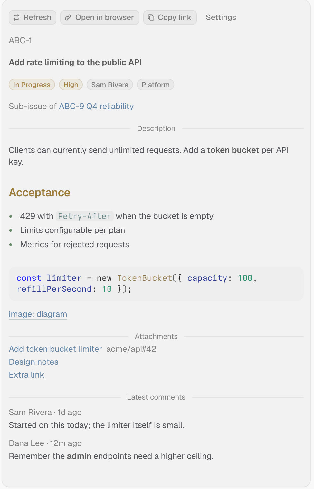
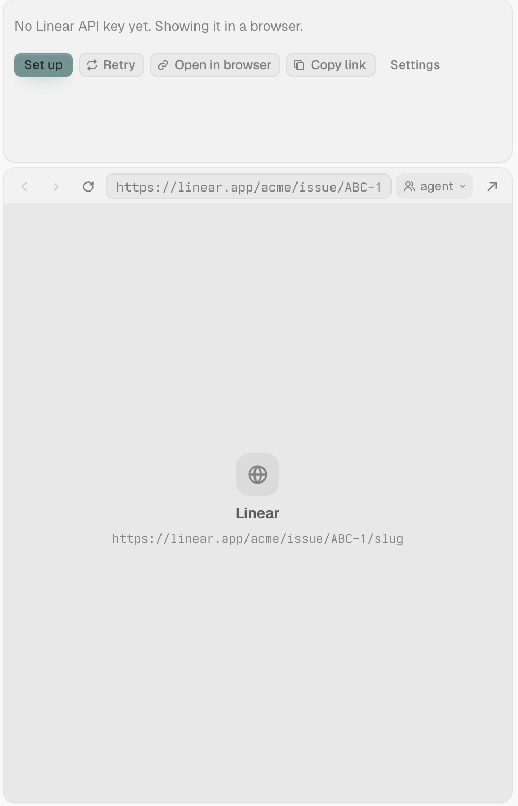

# Linear Sidebar for Tern

Click a Linear issue link in a Tern terminal and read the issue in a native, read-only
sidebar beside the pane you clicked in: title, state, priority, assignee, project, parent, description,
attachments and the latest comments. No browser tab, no context switch.



Coding agents such as omp print Markdown links as clickable terminal hyperlinks, so
`[ABC-123](https://linear.app/acme/issue/ABC-123)` in an agent's answer is one click away from the issue.

## Install

```sh
tern plugin install github.com/petermiles/tern-linear-sidebar
```

Pure Luau, nothing to build. Requires a Tern build with plugin blocks and `tern.route.link`.

## Use

Click an issue link (`https://linear.app/<workspace>/issue/<ID>[/<slug>]`) the way Tern opens links
(Cmd-click by default). The sidebar opens to the right of the pane that held the link. Clicking another issue
link re-points the same sidebar instead of opening a second one.

- **Alt-click** hands the link back to Tern's built-in handling.
- **Refresh**, **Open in browser** (Tern's own link handling, past this plugin) and **Copy link** sit on top of
  every view; **Settings** shows the connection and the agent rule.
- Attachments and the parent issue are links too, so a GitHub PR attachment goes through your other link
  routes (for example a GitHub sidebar plugin) like any clicked link.
- Each tab has one sidebar slot, shared with the companion
  [`github-sidebar`](https://github.com/petermiles/tern-github-sidebar) plugin: a Linear click takes over a
  GitHub sidebar in place and vice versa.

## Setup

The sidebar reads issues from Linear's GraphQL API with a personal API key
([create one](https://linear.app/settings/account/security); read access is enough).

1. Set `LINEAR_API_KEY` in the environment of Tern's daemon. It always wins and is never stored; or
2. click an issue link, press **Set up** and paste the key. It is checked with a `viewer` query and stored in
   this plugin's data folder (`credentials.json`, mode 600 in a 700 directory). **Settings → Sign out**
   deletes it.

Without a key, or when Linear cannot be reached or the issue is not visible to the key, the sidebar falls back
to a Tern browser showing the page, docked under a one-line note that says why (with **Set up** when there is
no key).



### Agent rule

Settings (and the setup screen) show an **Agent rule** section with this line, filled in with your workspace
and a team key from your account:

```
Write Linear tickets as Markdown links: [ABC-123](https://linear.app/acme/issue/ABC-123).
```

**Copy rule** copies it. For each of `~/.omp/agent/AGENTS.md`, `~/.claude/CLAUDE.md` and
`~/.codex/AGENTS.md` that exists there is an **Add to** / **Remove from** button. It appends the rule once
between `<!-- tern-linear-sidebar-rule:start -->` and `<!-- tern-linear-sidebar-rule:end -->` markers and
removes exactly that block again; pressing Add twice never duplicates it.

## Development

```sh
tern plugin link .          # use this checkout
tern plugin reload linear-sidebar
tern plugin types .         # writes tern.d.luau for luau-lsp (git-ignored)
```

`test/mock-linear.ts` is a stand-in for Linear's API (`bun test/mock-linear.ts`). Point the plugin at it with
`LINEAR_API_URL=http://127.0.0.1:4466/graphql LINEAR_API_KEY=lin_api_mock` in the daemon's environment.
`LINEAR_API_URL` is only honoured for `https://api.linear.app/graphql` and local addresses, so a hostile
environment cannot redirect your key.

How it fits together: `window.luau` claims links (`tern.route.link`) and manages the sidebar slot;
`host.luau` defines the `linear-sidebar.view` block. The block asks its window half for things only a window
can do (dock the fallback browser, open a URL past the routes) by opening an internal
`tern-linear-sidebar:` link that the route claims.

## License

MIT
